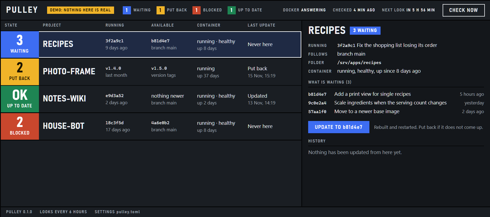
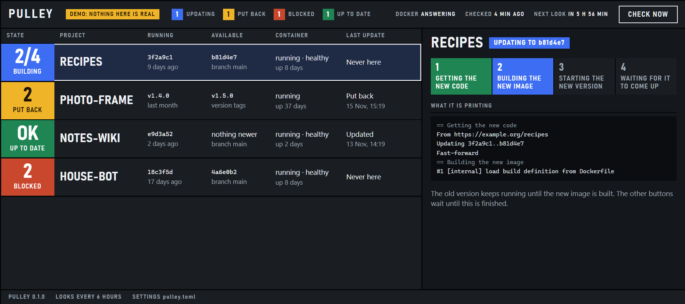
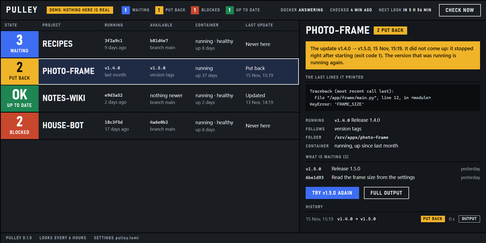

# Pulley

Updates for apps that run in Docker and are **built from a git checkout**.

Most update tools watch a registry for a new ready-made image. They can do nothing for an app whose image
is built on your own machine from its repository, which is how a lot of small projects are run. Pulley is
for those apps:

- It looks at the repository every few hours and shows what is new, commit by commit.
- It never updates anything on its own. You read the list and press **Update**.
- It builds the new image while the old container keeps running. A build that fails never takes the app down.
- It waits for the new version to come up. If it does not, the old one is put back.
- It keeps the image from before, so you can go back later with one button.







## What has and has not been tried

Pulley is new. Read this before you point it at something you care about.

| Part | State |
|---|---|
| The update steps (move the code, build, swap, wait, put back, go back) | Covered by tests that use real git and a stand-in for the `docker` command. Also run by hand once on a real Docker (Engine 29.9, Compose 5.7, Rocky Linux 9) with a small test app: a good update, a build that fails, a crash at start, a health check that passes and one that fails, a health address, going back, an override file, a missing value, a leftover one-off container, and stopping Pulley in the middle of an update. All behaved as described here. |
| A real project from GitHub | One: a Python app with its own Dockerfile, cloned two commits behind, started by hand and updated by Pulley. |
| `Dockerfile`, `compose.example.yaml` | Built and run on that same machine. |
| Other Docker and Compose versions, other Linux systems | Never tried. |
| The page | Driven in Chrome with made-up projects: an update, one that is put back, and going back, at desktop and phone width. Looked at in the dark theme only. It loads no fonts, so its headings use whatever condensed typeface the machine has. The page has no tests of its own. |
| A NAS (TrueNAS, Unraid, Synology) | Never tried. An app that the NAS's own app system manages is probably not one Pulley can see. |
| Docker Desktop on Windows or macOS | Not expected to work: folders cannot sit at the same path inside and outside (see below). |

## How an update goes

1. **Look again.** Pulley fetches the repository once more. If something newer arrived than the list you
   were shown, it stops and asks you to look again.
2. **Set the running image aside** under a name of its own, so it cannot be lost.
3. **Move the code forward.** Fast-forward only: nothing is merged or overwritten.
4. **Build** the new image. The old container is still running. If the build fails, the code is moved
   back and the app was never touched.
5. **Swap.** The container is replaced by one made from the new image. The app is away for a moment.
6. **Wait for it to come up** (see [Telling when an app is up](#telling-when-an-app-is-up)).
7. If it comes up, the old image is kept as the one to go back to. If it does not, the old code and the
   old image are **put back**, and the page says why, with the last lines the failed container printed.

Every attempt is kept in the project's history with everything git and Docker printed.

Pulley runs Compose exactly as the app's container says it was started: the same compose files (your own
`compose.override.yaml` included), the same folder and the same project name.

Pulley refuses to start an update, and says why, when:

- the checkout has been edited by hand (files git does not track, such as a data folder or an override
  file, are fine),
- the checkout has commits of its own, so it cannot simply move forward,
- it cannot see a running container for the service,
- the compose file uses a value Pulley does not have (see the last point below),
- restarting the app would give it a different folder than it has now (a path that means something
  else inside Pulley, such as `~`),
- the folders are not at the same path inside Pulley as on the machine.

## What an app needs

- It runs as a **Docker Compose service with a `build:` section**, from a git checkout on the machine.
- It was started once by hand from that folder: `docker compose up -d --build`.
- Its repository can be fetched without a password. Pulley holds no credentials.
- Anything its compose file takes from the shell (`${SOMETHING}`) is in a `.env` file next to the compose
  file. Pulley does not have your shell's variables, and would otherwise restart the app without them.
  Pulley notices a variable that has no value at all. It cannot notice one that has a *different* value
  inside its container, such as `${HOME}` or `${HOSTNAME}`: do not use those in the compose file.

## Setting it up

Pulley runs as a container on the same machine as the apps.

1. Clone this repository on that machine and copy `compose.example.yaml` to `compose.yaml`.
2. In it, choose a password and mount the folder that holds your checkouts **at the same path on both
   sides**:

   ```yaml
   services:
     pulley:
       build: .
       ports: ["8790:8790"]
       environment:
         PULLEY_PASSWORD: "choose-a-password"
       volumes:
         - /var/run/docker.sock:/var/run/docker.sock
         - ./data:/data
         - /srv/apps:/srv/apps
       restart: unless-stopped
   ```

3. Start it:

   ```bash
   docker compose up -d --build
   ```

4. Pulley writes a commented `data/pulley.toml` on its first start. Add your apps to it:

   ```toml
   [[project]]
   name = "myapp"
   path = "/srv/apps/myapp"
   service = "myapp"
   ```

5. Open `http://<the machine>:8790`, give the password (any user name), and press **Check now**.

**Why the same path.** Pulley tells the machine's Docker what to do, and a compose file's relative paths
(`./data:/data`) are worked out from where Pulley sees the folder. If that differs from where the folder
really is, the restarted app would get an empty folder in the wrong place and look as if it had lost its
data. Pulley checks this and refuses to update when the paths differ.

## Settings

`pulley.toml` is read again every time Pulley looks for updates, so changes need no restart.
[`pulley.example.toml`](pulley.example.toml) has every setting with a comment.

| Setting | What it does | Default |
|---|---|---|
| `check_every` | How often to look on its own: `"30m"`, `"6h"`, `"1d"`, `"never"` | `"6h"` |
| `name` | What the page calls the app | required |
| `path` | The git checkout the app is built from | required |
| `service` | Its service in the compose file | the name |
| `compose` | The compose file, when it is not `compose.yaml` or `docker-compose.yml` in `path` | found by name |
| `project_name` | The name given with `docker compose -p`, if the app was started with one | none |
| `follow` | `"branch"`: every new commit. `"tags"`: only new version tags | `"branch"` |
| `branch` | Which branch to follow | the one checked out |
| `tags` | With `follow = "tags"`: which tag names count, such as `"v*"` | all |
| `prereleases` | With `follow = "tags"`: also offer `-rc`, `-beta` and the like | `false` |
| `health_url` | An address that answers once the app is up | none |
| `health_wait` | How long the new version gets to come up | `"2m"` |
| `settle` | With nothing else to go by: how long it must stay running | `"20s"` |
| `build_wait` | How long a build may take | `"30m"` |
| `skip_path_check` | Do not check that the app would get the same folders after a restart | `false` |

Following `"branch"` offers every commit the moment it is pushed, finished or not. Follow `"tags"` when
the project tags its releases.

## Telling when an app is up

Pulley uses the first of these that applies:

1. **The image's own health check.** If the app's `Dockerfile` or compose file defines one, Pulley waits
   for Docker to call the container healthy.
2. **`health_url`.** Any answer that is not a server error counts, so a login page is fine. The address
   has to be reachable from Pulley's container: use the machine's address, not `localhost`.
3. **Staying up.** With neither, the container has to stay running, without being restarted, for `settle`.

With both a health check and a `health_url`, both have to pass. A container that stops, keeps restarting,
or is not up within `health_wait` counts as failed.

## Command line

The same things without the page, for instance over SSH:

```bash
docker exec pulley-pulley-1 pulley check
```

```bash
docker exec -it pulley-pulley-1 pulley update myapp
```

```bash
docker exec -it pulley-pulley-1 pulley back myapp
```

`update` and `back` show what they are about to do and ask first; `--yes` skips the question.

To see the page with made-up projects and no Docker anywhere (needs Python 3.11 or newer):

```bash
python -m pulley --demo
```

## Things to know

- **Pulley has full control of Docker, which is full control of the machine.** That is why it will not
  listen beyond the machine without a password, and why nothing is ever applied without a button press.
  The page is plain HTTP: keep it on your home network, or put it behind a reverse proxy that adds HTTPS.
  Behind a proxy, two things change: the proxy has to pass on the `Host` header or set
  `X-Forwarded-Host`, or the buttons are refused; and eight wrong passwords lock out everyone for ten
  minutes, because Pulley then sees every visitor as the proxy.
- **Going back takes the program back, not its data.** If the new version changed its database before
  failing, the old version may not read it. Pulley takes no snapshots.
- **An update runs whatever is in the repository.** Read the list of changes.
- Pulley runs as root in its container, so files it changes in a checkout end up owned by root.
- One earlier image is kept per project, as `pulley.local/<name>:previous`. Older ones are left without a
  name; `docker image prune` clears them.
- Pulley assumes the running container was built from what is checked out. If someone pulls by hand
  without rebuilding, the page shows the checkout, not what is running.
- One update at a time, and Pulley cannot update itself.
- Asked to stop in the middle of an update, Pulley finishes it first, for up to two and a half minutes
  (the example compose file gives it three). If it is killed anyway, the history says at which step it
  was. Check the app by hand.

## Working on it

Pulley is Python with nothing but the standard library. It drives `git` and `docker` as commands.

```bash
python -m unittest discover -s tests
```

The tests need Python 3.11 or newer and git. They make real repositories in a temporary folder and use
`tests/fakedocker.py` in place of Docker.

| File | What is in it |
|---|---|
| `pulley/engine.py` | Looking for updates, the update itself, putting back, going back, history |
| `pulley/git.py`, `pulley/docker.py` | The git and Docker commands Pulley uses |
| `pulley/config.py` | The settings file |
| `pulley/server.py`, `pulley/web/` | The page |
| `pulley/demo.py` | The made-up projects behind `--demo` |
| `pulley/cli.py` | The command line |

## Licence

MIT. See [LICENSE](LICENSE).
